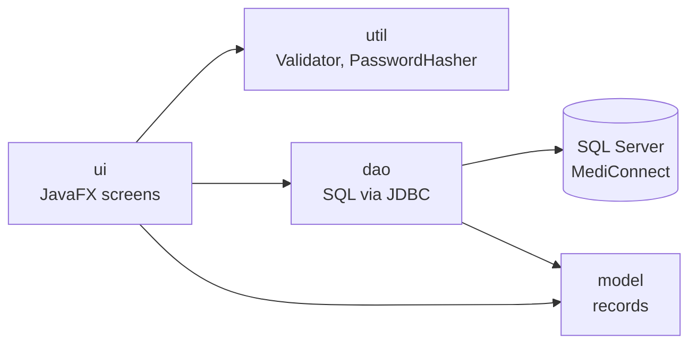
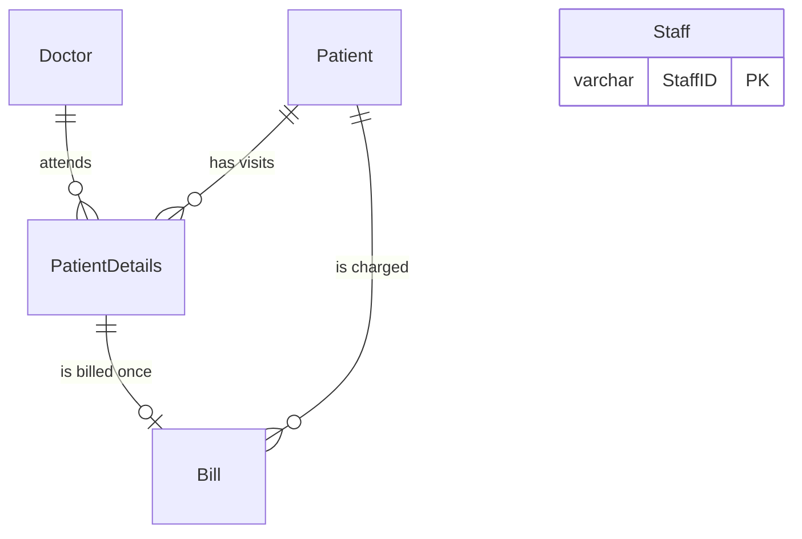

# MediConnect

A JavaFX desktop application that manages doctors, patients, visits, treatment records and billing for a medical center. Data is stored in a Microsoft SQL Server database.

> MediConnect was designed as a software-development case study: *OnTime Systems* builds the system for a medical center called *Philadelphia Medical Center (PMC)*, Great Lakes Region, USA.

---

## Table of Contents

1. [Overview](#overview)
2. [Key Features](#key-features)
3. [Technologies and Tools](#technologies-and-tools)
4. [Architecture and Folder Structure](#architecture-and-folder-structure)
5. [Prerequisites](#prerequisites)
6. [Installation and Setup](#installation-and-setup)
7. [Configuration](#configuration)
8. [Running the Project](#running-the-project)
9. [Usage](#usage)
10. [Screenshots](#screenshots)
11. [API Documentation](#api-documentation)
12. [Database Structure](#database-structure)
13. [Testing](#testing)
14. [Deployment](#deployment)
15. [Troubleshooting](#troubleshooting)
16. [Known Limitations and Roadmap](#known-limitations-and-roadmap)
17. [Contributing](#contributing)
18. [License](#license)
19. [Author and Contact](#author-and-contact)

---

## Overview

Staff at a busy medical center need to record doctors, patients, visits and payments quickly and look up a patient's history easily. MediConnect replaces manual record keeping with one application where a staff member:

1. logs in,
2. maintains doctor and patient records,
3. records each patient visit with diagnosis and treatment,
4. generates and prints bills, and
5. looks up information such as how many patients visited on a given date.

The application is a single-user desktop program. It connects directly to SQL Server over JDBC; there is no web server or API layer.

## Key Features

| Area | What the application does |
|---|---|
| **Staff login** | Staff ID and password check. Passwords are stored as salted PBKDF2 hashes, never as plain text. The login form locks for 30 seconds after 3 failed attempts. |
| **Doctors** | Add, view, update, delete and search (by ID, name or specialization). IDs are generated automatically (`D001`, `D002`, ...). |
| **Patients** | Add, view, update, delete and search (by ID, name or address). IDs are generated automatically (`P001`, ...). |
| **Visits and treatment** | Record a visit for a patient with a doctor, date, ailment, description, consultation fees and other expenses. The visit number is calculated from the patient's earlier visits. IDs are `V001`, `V002`, ... |
| **Billing** | Generate a bill for a visit (amount = consultation fees + other expenses, with payment mode Cash, Card, Cheque or Online). Each visit can be billed only once. Find earlier bills by patient ID, view the receipt, and print it. |
| **Display information** | Number of doctors, number of patients, patients who visited on a chosen date (with the visit list), total amount billed on a date, and a patient's full treatment history. |
| **Input validation** | Every form validates input (formats, ranges, required fields) and shows an error message instead of saving invalid data. The database adds its own constraints as a second layer. |
| **Safe deletion** | A doctor or patient who has visits, or a visit that has a bill, cannot be deleted; a clear message is shown. |
| **Exit and log out** | Both ask for confirmation. |

## Technologies and Tools

| Technology | Version | Purpose |
|---|---|---|
| Java (JDK) | 25 (`maven.compiler.release` in `pom.xml`) | Language and runtime |
| JavaFX (`javafx-controls`) | 25 | Desktop user interface |
| Microsoft SQL Server | 2025 | Database |
| Microsoft JDBC Driver for SQL Server (`mssql-jdbc`) | 12.10.0.jre11 | Database connectivity |
| Apache Maven | Any recent 3.x (no Maven wrapper is included) | Build and dependency management |
| `javafx-maven-plugin` | 0.0.8 | Runs the application with `mvn javafx:run` |

Java standard library features used: `PBKDF2WithHmacSHA256` for password hashing, `javafx.print.PrinterJob` for printing bills.

## Architecture and Folder Structure

The code is split into four layers. Screens never contain SQL, and database classes never touch the user interface.



```text
MediConnect/
├── pom.xml                          Maven build file
├── README.md
├── sql/
│   └── schema.sql                   Creates the database and its 5 tables
└── src/
    ├── main/
    │   ├── java/com/ontime/mediconnect/
    │   │   ├── MediConnectApp.java  Application entry point (login -> main window)
    │   │   ├── model/               Plain data records: Staff, Doctor, Patient, Visit, Bill
    │   │   ├── dao/                 All SQL (PreparedStatements)
    │   │   │   ├── Database.java        Opens connections from db.properties
    │   │   │   ├── IdGenerator.java     Next ID (D001, P001, V001, ...)
    │   │   │   ├── StaffDao.java        Authentication and default admin
    │   │   │   ├── DoctorDao.java
    │   │   │   ├── PatientDao.java
    │   │   │   ├── VisitDao.java        Table PatientDetails
    │   │   │   ├── BillDao.java
    │   │   │   └── CountDao.java        Count queries
    │   │   ├── util/
    │   │   │   ├── Validator.java       Input validation rules
    │   │   │   └── PasswordHasher.java  Salted PBKDF2 hashing
    │   │   └── ui/                  JavaFX screens
    │   │       ├── LoginView.java
    │   │       ├── MainView.java        Left menu + content area
    │   │       ├── DoctorView.java
    │   │       ├── PatientView.java
    │   │       ├── VisitView.java
    │   │       ├── BillView.java
    │   │       ├── QueryView.java
    │   │       ├── VisitTable.java      Visits table shared by two screens
    │   │       └── Ui.java              Dialogs, form helpers, SQL error messages
    │   └── resources/
    │       ├── db.properties        Database connection settings
    │       └── style.css            Application styling
    └── test/java/
        └── CoreChecks.java          Plain-Java checks that need no database
```

## Prerequisites

| Requirement | Notes |
|---|---|
| **JDK 25** | `pom.xml` sets `maven.compiler.release` to 25, so older JDKs will not compile the project. Check with `java -version`. |
| **Apache Maven** | Check with `mvn -version`. Maven downloads JavaFX and the JDBC driver on first build, so an internet connection is needed once. |
| **Microsoft SQL Server** | The default connection uses `localhost:1433` with SQL authentication. TCP/IP must be enabled, and the login in `db.properties` (default `sa`) must be allowed to sign in with a password (mixed-mode authentication). |
| **SQL client** | SQL Server Management Studio (SSMS) or `sqlcmd`, to run `sql/schema.sql`. |
| **Printer (optional)** | Only needed to print bills. |

## Installation and Setup

**1. Get the project**

```bash
cd MediConnect
```

(Use the folder that contains `pom.xml`.)

**2. Create the database**

Run `sql/schema.sql` once. In SSMS, open the file and execute it. With `sqlcmd` (it prompts for the password):

```bash
sqlcmd -S localhost -U sa -C -i sql/schema.sql
```

`-C` trusts the server certificate, matching the default `trustServerCertificate=true` in the connection URL. The script creates the `MediConnect` database and five tables: `Staff`, `Doctor`, `Patient`, `PatientDetails`, `Bill`.

> The script is meant to run once. Running it a second time fails because the tables already exist. To start over, drop the `MediConnect` database and run it again.

**3. Configure the connection**

Edit `src/main/resources/db.properties` (see [Configuration](#configuration)).

## Configuration

MediConnect does **not** use environment variables or a `.env` file. All settings live in one file, `src/main/resources/db.properties`, which is loaded from the classpath at startup:

```properties
# Edit to match your SQL Server instance.
url=jdbc:sqlserver://localhost:1433;databaseName=MediConnect;encrypt=true;trustServerCertificate=true
user=sa
password=<your-sql-server-password>
```

| Key | Description |
|---|---|
| `url` | JDBC connection string: host, port, database name and encryption options. |
| `user` | SQL Server login name. |
| `password` | Password for that login. |

## Running the Project

From the folder that contains `pom.xml`:

```bash
mvn javafx:run
```

This compiles the code and starts the application. The login window opens.

**First login.** If the `Staff` table is empty, the application creates one default account at startup:

| Staff ID | Password |
|---|---|
| `S001` | `Admin@123` |

## Usage

1. **Log in** with your Staff ID (format: `S` plus three digits, e.g. `S001`) and password.
2. Use the **left menu** to open a screen:

| Menu item | What you can do |
|---|---|
| **Doctors** | Fill the form and press **Add**. Click a row in the table to load it, then **Update** or **Delete**. **Clear** empties the form. The search box filters the table as you type. |
| **Patients** | Same as Doctors, with gender, age, blood group, weight (kg) and height (cm). |
| **Visits & Treatment** | Choose a patient and a doctor, set the date, and enter ailment, optional description, consultation fees and other expenses. The visit number is shown automatically. The patient of an existing visit cannot be changed. |
| **Billing** | Pick an unbilled visit, choose a payment mode and press **Generate bill**. A receipt appears; press **Print** to print it. To see old bills, enter a patient ID, press **Find bills**, select a row and press **Show selected bill**. |
| **Display Information** | Use the buttons for doctor and patient counts, patients who visited on a date, amount billed on a date, and a patient's history (enter a patient ID). |
| **Log out / Exit** | Both ask for confirmation. |

**Validation rules** (enforced in `Validator.java`):

| Field | Rule |
|---|---|
| Name | 2-50 characters: letters, spaces, `.`, `'`, `-` |
| Phone | 7-14 digits, optional leading `+` |
| Email | Valid format, at most 30 characters |
| Age | Whole number 0-120 |
| Gender | `M`, `F` or `O` |
| Blood group | `A`, `B`, `AB` or `O` followed by `+` or `-` |
| Weight / Height | Greater than 0 and less than 1000 |
| Fees | Not negative, at most 2 decimal places |
| Checkup date | Required, cannot be in the future |

## Screenshots

## API Documentation

Not applicable. MediConnect is a desktop application that talks directly to the database; it exposes no HTTP endpoints or other API.

## Database Structure

Database name: `MediConnect` (SQL Server). Defined in `sql/schema.sql`.



`Staff` is independent: it is used only for login.

### Staff

| Column | Type | Constraints |
|---|---|---|
| StaffID | VARCHAR(4) | PK |
| StaffName | VARCHAR(50) | NOT NULL |
| PasswordHash | VARCHAR(200) | NOT NULL (`iterations:salt:hash`, PBKDF2-HMAC-SHA256) |

### Doctor

| Column | Type | Constraints |
|---|---|---|
| DoctorID | VARCHAR(4) | PK |
| Name | VARCHAR(50) | NOT NULL |
| Specialization | VARCHAR(50) | NOT NULL |
| PhoneNo | VARCHAR(15) | NOT NULL |
| EmailID | VARCHAR(30) | NOT NULL |

### Patient

| Column | Type | Constraints |
|---|---|---|
| PatientID | VARCHAR(4) | PK |
| Name | VARCHAR(50) | NOT NULL |
| Address | VARCHAR(40) | NOT NULL |
| Gender | VARCHAR(1) | NOT NULL, `M`/`F`/`O` |
| Age | INT | NOT NULL, 0-120 |
| BloodGroup | VARCHAR(4) | NOT NULL |
| Weight | DECIMAL(5,2) | NOT NULL, > 0 |
| Height | DECIMAL(5,2) | NOT NULL, > 0 |

### PatientDetails (one row per visit)

| Column | Type | Constraints |
|---|---|---|
| PatientDetailsID | VARCHAR(4) | PK |
| DoctorID | VARCHAR(4) | NOT NULL, FK to `Doctor` |
| PatientID | VARCHAR(4) | NOT NULL, FK to `Patient` |
| Ailment | VARCHAR(50) | NOT NULL |
| Description | VARCHAR(150) | NULL |
| CheckupVisitNumber | INT | NOT NULL |
| CheckupDate | DATE | NOT NULL |
| ConsFees | DECIMAL(10,2) | NOT NULL, >= 0 |
| OtherExpenses | DECIMAL(10,2) | NOT NULL, >= 0 |

### Bill

| Column | Type | Constraints |
|---|---|---|
| BillID | INT IDENTITY | PK |
| PatientDetailsID | VARCHAR(4) | NOT NULL, UNIQUE, FK to `PatientDetails` |
| PatientID | VARCHAR(4) | NOT NULL, FK to `Patient` |
| BillDate | DATETIME | NOT NULL, default current time |
| BillAmount | DECIMAL(10,2) | NOT NULL, >= 0 |
| ModeOfPayment | VARCHAR(6) | NOT NULL, `Cash`/`Card`/`Cheque`/`Online` |

## Testing

```bash
mvn test-compile
```

then run it (use `;` instead of `:` on Windows):

```bash
java -cp target/classes:target/test-classes CoreChecks
```

Expected last line: `ALL CHECKS PASSED`. The program exits with a non-zero status if any check fails.

The database access code and the JavaFX screens have **no automated tests**. Test them manually, for example:

| Scenario | Expected result |
|---|---|
| Log in with `S001` and a wrong password | Error message with attempts left; locked for 30 seconds after the third failure |
| Add a doctor with an invalid email | Error dialog; nothing saved |
| Add a doctor with valid data | Saved with the next ID (e.g. `D001`) and shown in the table |
| Delete a doctor who has visits | Refused with a message |
| Add two visits for the same patient | Visit numbers 1 and 2 |
| Generate a bill for a visit | Receipt total equals consultation fees + other expenses; the visit disappears from the unbilled list |
| Search "Patients who visited" for a date with visits | Correct count and visit list |

## Deployment

No deployment or packaging setup exists in the project. `pom.xml` configures only `javafx-maven-plugin` for `mvn javafx:run`; it does not build a runnable (fat) JAR, native installer or `jlink` image. Running on another computer currently means installing JDK 25, Maven and SQL Server there, creating the database with `sql/schema.sql`, and running `mvn javafx:run`.

## Troubleshooting

| Message or symptom | Likely cause and fix |
|---|---|
| *"Cannot connect to the database. Check that SQL Server is running and db.properties is correct."* | SQL Server is stopped, TCP/IP is disabled, or the host/port in `url` is wrong. |
| *"The database rejected the login in db.properties. Check the user name and password."* | Wrong `user` or `password`, or the login does not allow SQL authentication. |
| `mssql-jdbc:12.10.0.jre11` not found by Maven | Replace the version in `pom.xml` with the newest `.jre11` release on Maven Central. |
| `release version 25 not supported` | Maven is using an older JDK. Set `JAVA_HOME` to JDK 25. |
| Changes to a source file do not appear | Stop the running application and start it again with `mvn javafx:run`. |
| *"This record is used by other records..."* | Expected: delete the dependent visits or bills first. |
| Tables already exist when running `schema.sql` | The script was already run. Drop the database to start over. |

## Known Limitations and Roadmap

Limitations present in the current code:

- **No staff management screen.** Only the default `S001` account is created automatically. There is no screen to add staff or change a password; this has to be done directly in the database (passwords must be stored as hashes produced by `PasswordHasher`).
- **IDs are limited to 999 records per table** (`D001`-`D999`, etc.). The next ID is calculated from the highest existing one, which is not safe if two copies of the application add records at the same moment.
- **Database calls run on the UI thread** and each call opens a new connection (no connection pool), so a slow database can make the window freeze briefly.
- **Credentials sit in a plain file** (`db.properties`) rather than environment variables or a secrets store.
- **No role-based access:** every logged-in staff member can do everything.
- **No automated tests** for the database or UI layers; no logging framework.

Possible improvements:

- [ ] Staff management and a "change password" screen
- [ ] Role-based permissions (e.g. reception vs. administrator)
- [ ] JUnit tests and integration tests against a test database
- [ ] Connection pooling and background threads for database calls
- [ ] Database sequences for ID generation
- [ ] Read database settings from environment variables, with a `db.properties.example` file
- [ ] Runnable installer or `jlink` package for easier deployment
- [ ] Export of bills and reports to PDF

## License

No license file is included in the project, so all rights are reserved by default. Add a `LICENSE` file (for example MIT or Apache-2.0) and update this section to state which license applies.

## Author and Contact

- **Author:** Aadan Yusuf
- **Developed for:** OnTime Systems (case-study client: Philadelphia Medical Center)
